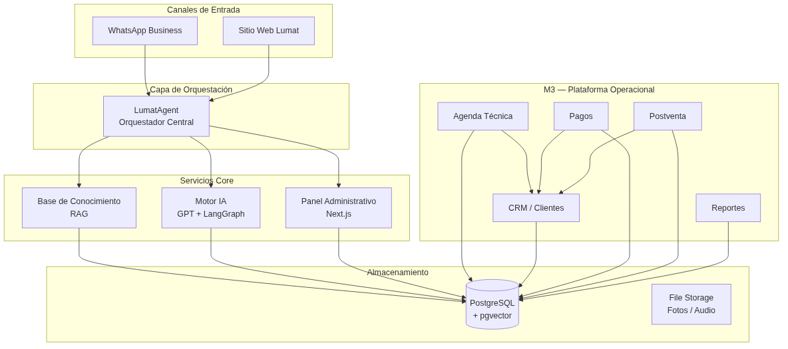
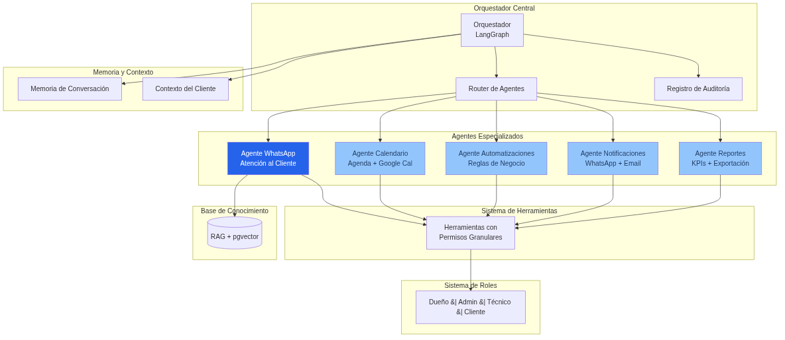
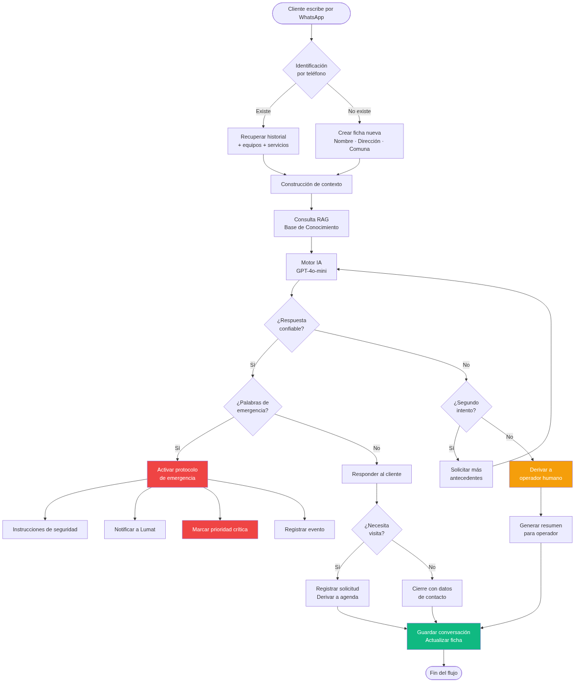
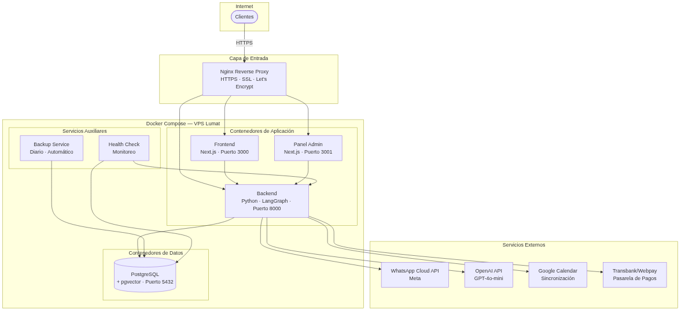

# Propuesta Técnica y Económica

## Sistema Inteligente de Atención y Gestión Digital para Lumat

**Preparado para**

**Lumat**

---

### Elaborado por

**HandCodeStudio**

Arquitectura de Software · Inteligencia Artificial · Automatización de Procesos

---

**Contacto Comercial**

Stefan Miranda

---

**Fecha**

Julio 2026

---

**Versión**

2.0

---

**Documento Confidencial**

La información contenida en este documento corresponde a una propuesta técnica y económica preparada exclusivamente para Lumat. Su contenido no podrá ser distribuido ni utilizado para fines distintos a la evaluación del proyecto sin autorización expresa de HandCodeStudio.

---

<div class="page-break"></div>

# Índice

1. Resumen Ejecutivo
2. Entendimiento del Proyecto
3. Objetivos
4. Alcance General
5. Arquitectura de la Solución
6. Stack Tecnológico
7. Milestone 1 — LumatAgent
8. Milestone 2 — Página Web
9. Milestone 3 — Plataforma Operacional
10. Infraestructura
11. Costos Operativos
12. Soporte
13. Garantías
14. Seguridad
15. Propiedad Intelectual
16. Continuidad del Proyecto
17. Riesgos y Dependencias
18. Roadmap
19. Matriz de Trazabilidad
20. Resumen Económico
21. Próximos Pasos
Anexo A — Flujo Conversacional Completo
Anexo B — Glosario Técnico
Anexo C — Cronograma del Proyecto

<div class="page-break"></div>

# 1. Resumen Ejecutivo

## Una plataforma diseñada para acompañar el crecimiento de Lumat

Durante el análisis del documento de requerimientos se identificó que la necesidad de Lumat va mucho más allá de incorporar un chatbot para responder mensajes de WhatsApp.

El objetivo real del proyecto consiste en construir una plataforma digital que permita centralizar la atención de clientes, registrar información operacional, mejorar los tiempos de respuesta y establecer una base tecnológica capaz de evolucionar junto con el crecimiento de la empresa.

La solución propuesta considera una implementación progresiva mediante tres milestones independientes, cada uno con objetivos claros y entregables definidos.

Esta estrategia permite comenzar obteniendo resultados concretos en el corto plazo, mientras se construye una arquitectura preparada para futuras automatizaciones sin necesidad de rehacer el sistema.

---

## Los tres pilares del proyecto

### Milestone 1 — LumatAgent

Implementación de un asistente inteligente conectado a WhatsApp capaz de:

- Atender consultas
- Recopilar información
- Clasificar casos
- Detectar emergencias
- Registrar clientes
- Asistir al equipo técnico

Este componente constituye el núcleo del ecosistema digital. Se presenta en **tres opciones** con distinta profundidad arquitectónica para que Lumat elija según su presupuesto y plan de crecimiento.

---

### Milestone 2 — Sitio Web Corporativo

Desarrollo de un sitio web moderno y administrable que permita:

- Presentar los servicios de Lumat
- Generar nuevos contactos
- Integrar el Bot IA
- Facilitar el acceso a WhatsApp
- Fortalecer la presencia digital de la empresa

---

### Milestone 3 — Plataforma Operacional

Incorporación de capacidades de gestión como:

- Agenda técnica
- Asignación de técnicos
- Historial de clientes
- Pagos
- Postventa
- Automatizaciones
- Reportes

Con este milestone el sistema evoluciona desde una herramienta de atención hacia una plataforma integral para la operación del negocio.

---

## Filosofía de la solución

Uno de los principios fundamentales considerados durante el diseño de esta propuesta es evitar la dependencia tecnológica del proveedor.

Por esta razón:

- El código fuente será propiedad de Lumat.
- La infraestructura quedará bajo control de Lumat.
- Las cuentas de terceros permanecerán a nombre de Lumat.
- La base de datos pertenecerá a Lumat.
- Otro desarrollador podrá continuar el proyecto si fuera necesario.

De esta manera la inversión realizada permanece como un activo tecnológico de la empresa.

**Stack tecnológico**: VPS propio de Lumat + Docker + PostgreSQL + Python + LangGraph (IA) + Next.js + WhatsApp Cloud API. Sin dependencia de proveedor — los datos y el código quedan bajo control de Lumat.

---

## Beneficios esperados

Al finalizar la implementación, Lumat dispondrá de una plataforma que permitirá:

✓ Atención al cliente 24/7.

✓ Centralización de toda la información.

✓ Historial completo por cliente.

✓ Menor pérdida de oportunidades comerciales.

✓ Reducción de tiempos administrativos.

✓ Base tecnológica preparada para crecer.

✓ Mayor trazabilidad operacional.

✓ Integraciones futuras sin rediseñar la arquitectura.

<div class="page-break"></div>

# 2. Entendimiento del Proyecto

## Nuestra comprensión del desafío

El documento de requerimientos preparado por Lumat refleja una visión de crecimiento de largo plazo.

Más que resolver una necesidad puntual de atención por WhatsApp, el proyecto busca construir una plataforma que acompañe la evolución operacional de la empresa durante los próximos años.

Actualmente gran parte de la interacción con los clientes ocurre mediante conversaciones de WhatsApp. Esto presenta desafíos habituales:

- Información distribuida en múltiples conversaciones
- Dificultad para realizar seguimiento
- Escasa trazabilidad
- Pérdida de antecedentes técnicos
- Dependencia del conocimiento de cada persona
- Dificultades para medir indicadores de gestión

La propuesta presentada responde a estos desafíos mediante una arquitectura escalable que transforma cada interacción con el cliente en información estructurada y reutilizable.

---

## Principios de diseño

Durante la elaboración de esta propuesta se definieron los siguientes principios arquitectónicos:

### Escalabilidad
Cada milestone amplía las capacidades del sistema sin reemplazar componentes previamente desarrollados.

### Modularidad
Cada componente puede evolucionar de manera independiente.

### Propiedad
Toda la información pertenece a Lumat.

### Transparencia
Los costos operativos se presentan de forma separada del costo de desarrollo.

### Seguridad
La información de clientes será protegida mediante mecanismos modernos de autenticación, autorización, cifrado y respaldo.

### Continuidad
La solución podrá ser mantenida por cualquier desarrollador con conocimientos del stack propuesto.

---

## Visión de largo plazo

La arquitectura propuesta no está diseñada únicamente para responder consultas. Su objetivo es evolucionar gradualmente hasta convertirse en un asistente operacional capaz de colaborar con las actividades diarias de Lumat.

Esta evolución permitirá incorporar en el futuro funcionalidades como:

- Planificación automática
- Automatización de procesos
- Generación de reportes
- Coordinación de visitas técnicas
- Seguimiento postventa
- Nuevas integraciones con herramientas externas

Gracias a esta estrategia, la inversión realizada durante el Milestone 1 continúa aportando valor en todas las etapas posteriores.

<div class="page-break"></div>

# 3. Objetivos

## Objetivo General

Diseñar e implementar una plataforma digital inteligente que permita mejorar la atención al cliente, optimizar los procesos internos y proporcionar una infraestructura tecnológica escalable para el crecimiento de Lumat.

---

## Objetivos Específicos

### Atención Inteligente
Implementar un asistente virtual basado en Inteligencia Artificial capaz de atender clientes mediante WhatsApp, responder consultas frecuentes y registrar información relevante.

### Centralización de Información
Construir una base de datos única que consolide clientes, conversaciones, historial técnico y futuras operaciones.

### Digitalización Operacional
Reducir procesos manuales mediante herramientas de gestión, automatización y seguimiento.

### Escalabilidad Tecnológica
Diseñar una arquitectura preparada para incorporar nuevas funcionalidades sin necesidad de rediseñar el sistema.

### Independencia Tecnológica
Garantizar que la propiedad del código, la información y la infraestructura permanezcan bajo control de Lumat.

<div class="page-break"></div>

# 4. Alcance General

La implementación se desarrollará mediante tres milestones independientes pero completamente compatibles entre sí. Cada milestone es independiente y puede contratarse por separado.

| Milestone | Objetivo | Resultado |
|-----------|----------|-----------|
| **M1** | Atención inteligente | LumatAgent operativo en WhatsApp |
| **M2** | Presencia digital | Sitio web conectado al ecosistema |
| **M3** | Gestión operacional | Agenda, CRM, pagos y automatizaciones |

Cada etapa podrá comenzar una vez aprobada la anterior o ejecutarse según la planificación definida por Lumat.

Esta estrategia reduce el riesgo del proyecto, permite validar resultados de forma progresiva y distribuye la inversión en el tiempo.

<div class="page-break"></div>

# 5. Arquitectura de la Solución

La plataforma Lumat está diseñada bajo una arquitectura modular, con componentes desacoplados que se comunican mediante APIs. La base de datos centralizada (PostgreSQL + pgvector) unifica toda la información, y la infraestructura sobre Docker Compose garantiza portabilidad y control.



## Arquitectura Multi-Agente

El LumatAgent implementa un patrón de orquestador multi-agente donde un motor central coordina agentes especializados que operan con herramientas de permisos granulares.



## Principios Arquitectónicos

- Arquitectura modular y desacoplada
- Base de datos centralizada
- Integraciones mediante APIs
- Escalabilidad horizontal
- Independencia del proveedor
- Preparada para agentes especializados

<div class="page-break"></div>

# 6. Stack Tecnológico

La plataforma será construida utilizando tecnologías modernas, ampliamente adoptadas por la industria y orientadas a la escalabilidad.

| Componente | Tecnología |
|------------|------------|
| Backend | Python |
| Framework IA | LangGraph |
| Modelos IA | OpenAI GPT |
| Base Vectorial | pgvector |
| Base de Datos | PostgreSQL |
| Frontend Web | Next.js |
| Panel Administrativo | Next.js |
| Infraestructura | Docker |
| Servidor | VPS dedicado (Hetzner) |
| Integración WhatsApp | WhatsApp Business Cloud API |
| Autenticación | JWT + Roles |
| Archivos | Almacenamiento seguro en servidor |
| Versionamiento | Git |
| Despliegue | Docker Compose |

<div class="page-break"></div>

# 7. Milestone 1 — LumatAgent

## Plataforma Inteligente de Atención al Cliente

> **Objetivo del Milestone**
>
> Implementar un asistente inteligente capaz de atender clientes mediante WhatsApp, responder consultas utilizando únicamente información autorizada por Lumat, recopilar antecedentes técnicos, clasificar solicitudes, detectar situaciones de emergencia, registrar automáticamente cada interacción y facilitar la derivación a un operador humano cuando sea necesario. Este milestone constituye la base tecnológica sobre la cual evolucionarán las futuras capacidades operacionales del sistema.

---

## 7.1 Visión General

El **LumatAgent** es el núcleo del ecosistema digital propuesto.

No se trata únicamente de un chatbot con respuestas predefinidas, sino de un sistema capaz de comprender el contexto de cada cliente, consultar una base de conocimiento administrable, mantener memoria de las conversaciones y asistir al equipo de Lumat durante todo el ciclo de atención.

Cada interacción genera información estructurada que queda disponible para futuras consultas, reportes y automatizaciones.

### Objetivos del Milestone

Al finalizar esta etapa, Lumat dispondrá de una solución capaz de:

- Atender clientes 24 horas al día mediante WhatsApp
- Responder preguntas frecuentes utilizando únicamente información autorizada
- Identificar automáticamente a clientes existentes
- Crear fichas de nuevos clientes
- Registrar conversaciones y archivos enviados
- Detectar emergencias y activar protocolos definidos
- Clasificar solicitudes según prioridad
- Generar resúmenes automáticos para el equipo técnico
- Derivar casos complejos a un operador humano
- Administrar toda la información desde un panel web
- Exportar clientes y solicitudes
- Mantener una base de conocimiento editable sin modificar código

---

## 7.2 Arquitectura Funcional

El LumatAgent opera con un orquestador de conversación central que coordina la identificación del cliente, el motor IA (GPT + RAG), la base de conocimiento y el motor de decisiones. Este último gestiona emergencias, derivación a operador humano y registro estructurado de cada interacción en PostgreSQL + pgvector. Toda la administración se realiza desde el panel web.

### Principios Arquitectónicos

- Arquitectura desacoplada
- Persistencia completa de información
- Separación entre conocimiento e IA
- Componentes reutilizables
- Escalable hacia arquitectura multi-agente
- Preparado para futuras automatizaciones

---

## 7.3 Flujo Conversacional

Uno de los principales entregables del proyecto corresponde al diseño y documentación del flujo conversacional del asistente. El flujo completo se detalla en el Anexo A de este documento.



### Construcción del Contexto

Antes de responder, el sistema reúne automáticamente:

- Datos del cliente
- Historial de conversaciones
- Equipos registrados
- Servicios realizados
- Información autorizada por Lumat
- Base de conocimiento
- Estado actual del caso

De esta forma, el cliente no necesita repetir información en cada contacto.

### Menú Inicial Requerido

El bot presentará las siguientes categorías de atención:

- Calefont
- Caldera
- Sistema de calefacción
- Solicitar visita técnica
- Consultar por un servicio o valor
- Postventa o garantía
- Emergencia
- Hablar con una persona

### Datos que Recopila

| Categoría | Datos requeridos |
|-----------|-----------------|
| **Identificación** | Nombre completo, teléfono/WhatsApp y correo electrónico |
| **Ubicación** | Comuna y dirección del servicio |
| **Equipo** | Tipo de equipo, marca, modelo y antigüedad aproximada |
| **Falla** | Descripción del problema, código de error, momento y frecuencia |
| **Evidencia** | Fotografías, videos o audio cuando corresponda |
| **Disponibilidad** | Días y horarios preferentes para una visita |
| **Consentimiento** | Aceptación para almacenar datos con fines de atención |

---

## 7.4 Arquitectura RAG

Una de las características más importantes del sistema es la utilización de una arquitectura **Retrieval-Augmented Generation (RAG)**.

Esto significa que el asistente **no responde únicamente utilizando un modelo de IA**, sino que consulta primero la información oficial proporcionada por Lumat.

**Flujo RAG:**
1. Pregunta del cliente
2. Búsqueda de documentos relacionados en la base de conocimiento
3. Recuperación de información relevante
4. El modelo GPT genera la respuesta fundamentada
5. Respuesta al cliente

### Beneficios

- Reduce alucinaciones
- Evita inventar respuestas
- Facilita actualizar información sin modificar código
- Permite ampliar el conocimiento progresivamente
- Mantiene consistencia en las respuestas

---

## 7.5 Gestión de la Base de Conocimiento

El sistema incorporará un módulo administrativo para gestionar el conocimiento utilizado por el asistente.

Será posible:

- Incorporar documentos PDF y manuales técnicos
- Agregar preguntas frecuentes
- Editar información comercial
- Actualizar servicios, horarios y garantías
- Incorporar nuevos códigos de error
- Eliminar información obsoleta

Las modificaciones estarán disponibles para el asistente sin necesidad de realizar nuevos desarrollos.

La base de conocimiento inicial incluirá:

- Información institucional y comercial de Lumat
- Servicios disponibles y comunas de cobertura
- Horarios de atención y canales de contacto
- Valores referenciales y reglas de cotización
- Formas de pago, garantías y política de cancelación
- Preguntas frecuentes de venta y postventa
- Problemas frecuentes de calefont, calderas y calefacción
- Códigos de error por marca y modelo
- Procedimientos de derivación y criterios de emergencia

---

## 7.6 Memoria del Sistema

A diferencia de un chatbot tradicional, el LumatAgent mantiene memoria operacional.

Después de cada conversación:

- Genera un resumen automático
- Actualiza la ficha del cliente
- Registra nuevos equipos
- Identifica patrones recurrentes
- Registra preguntas sin respuesta para enriquecer la base de conocimiento

Esto permite que el sistema mejore continuamente con el uso.

---

## 7.7 Detección de Emergencias

El sistema supervisará permanentemente expresiones relacionadas con situaciones críticas:

- Fuga de gas, olor a gas
- Humo, chispa, incendio, explosión
- Monóxido, intoxicación
- Riesgo eléctrico, filtración severa

Cuando se detecte una situación de riesgo:

1. Se interrumpirá el flujo comercial
2. Se mostrarán instrucciones de seguridad aprobadas por Lumat
3. Se recomendará contactar a los servicios de emergencia cuando corresponda
4. Se notificará automáticamente al equipo de Lumat
5. El caso quedará marcado con prioridad crítica

### Orientación Técnica Permitida

El bot podrá realizar preguntas de diagnóstico preliminar y entregar recomendaciones básicas de bajo riesgo. No podrá confirmar diagnósticos definitivos, indicar intervenciones peligrosas ni reemplazar la revisión de un técnico.

- Preguntar si el equipo enciende, si muestra un código y si el problema afecta calefacción, agua caliente o ambos
- Solicitar fotografías de la pantalla, manómetro o instalación visible
- Recomendar verificaciones simples y seguras previamente aprobadas por Lumat
- Indicar cuando la información no es suficiente y se requiere visita técnica
- Mostrar una advertencia de seguridad cuando corresponda

---

## 7.8 Derivación a Atención Humana

El asistente derivará automáticamente una conversación cuando:

- El cliente solicite hablar con una persona
- No exista una respuesta confiable tras dos intentos
- Exista una emergencia o riesgo para personas o instalaciones
- Corresponda un reclamo, garantía o cliente molesto
- Se requiera una cotización personalizada
- Sea necesario revisar fotografías o videos con criterio técnico
- La información técnica sea insuficiente o contradictoria

La derivación incluirá un resumen completo de la conversación para evitar que el cliente deba repetir la información ya entregada.

---

## 7.9 Panel Administrativo

El panel web permitirá gestionar toda la operación del asistente.

### Módulos incluidos

- Dashboard con indicadores
- Gestión de clientes
- Conversaciones
- Bandeja de casos pendientes y derivados
- Base de conocimiento
- Configuración del asistente
- Usuarios y roles
- Reportes
- Exportaciones (Excel / CSV)

### Dashboard

Mostrará indicadores como:
- Nuevos contactos
- Solicitudes de visita
- Emergencias detectadas
- Derivaciones
- Conversaciones atendidas
- Estado de los casos

### Gestión de Clientes

Cada cliente contará con una ficha única que incluirá:
- Datos personales
- Dirección
- Equipos registrados
- Historial de conversaciones y visitas
- Fotografías y archivos
- Notas internas
- Estado del caso

### Gestión de Conversaciones

Los operadores podrán:
- Revisar conversaciones completas
- Filtrar por estado
- Buscar por cliente
- Reasignar casos
- Agregar comentarios internos

### Registro y Ficha del Cliente

- Crear ficha automática al primer contacto
- Reconocer clientes existentes por número de teléfono
- Guardar datos personales, conversaciones, archivos y solicitudes
- Evitar registros duplicados
- Permitir agregar notas internas
- Registrar fecha, hora, canal y responsable
- Mantener estados: nuevo, contactado, pendiente, agendado, en evaluación, finalizado, cancelado y postventa

---

## 7.10 Seguridad

La plataforma incorporará:

- Autenticación mediante usuarios y contraseñas
- Roles diferenciados (Administrador y Operador)
- Acceso HTTPS
- Cifrado de credenciales
- Registro de auditoría
- Respaldos automáticos
- Protección frente a registros duplicados

---

## 7.11 Gestión de Costos de IA

Para responder al requerimiento de Lumat de mantener visibles y controlables los costos operativos, el sistema incorporará indicadores de consumo y alertas configurables.

El panel permitirá visualizar:

- Consumo estimado de tokens
- Uso de la API de IA
- Consumo de embeddings
- Uso de WhatsApp Business
- Proyección mensual de costos

Cuando se alcancen umbrales definidos por Lumat, el sistema podrá generar alertas para facilitar el control del gasto.

---

## 7.12 Requisitos de Inteligencia Artificial

- Responder únicamente utilizando la información autorizada por Lumat
- Reconocer cuando no dispone de una respuesta confiable
- Evitar inventar precios, diagnósticos, garantías o disponibilidad
- Registrar las respuestas no resueltas para mejorar la base de conocimiento
- Permitir ajustar el tono, mensajes y reglas del bot
- Incluir límites de consumo y alertas de costo
- Indicar el modelo o proveedor de IA propuesto y sus costos

---

## 7.13 Entregables del Milestone

- Diseño y documentación del flujo conversacional
- Arquitectura documentada
- Bot funcional en ambiente de pruebas
- Integración con WhatsApp Business
- Base de conocimiento inicial cargada
- Panel administrativo
- Captura estructurada de clientes
- Registro de conversaciones
- Gestión de archivos (fotos, audio)
- Detección de emergencias y protocolo de seguridad
- Derivación humana con resumen de conversación
- Exportación CSV / Excel
- Manual de usuario
- Capacitación remota
- Entrega de cuentas, accesos y documentación técnica

---

## 7.14 Criterios de Aceptación

El milestone se considerará aceptado cuando:

- El bot complete correctamente los flujos acordados
- Los datos se registren sin duplicaciones evidentes
- Las conversaciones puedan derivarse a un operador
- Las emergencias activen el protocolo definido
- El administrador pueda revisar clientes, conversaciones y estados
- La información pueda exportarse
- La base de conocimiento pueda actualizarse sin modificar código
- Los costos operativos sean visibles y controlables
- Las cuentas y los datos queden bajo control de Lumat

---

## 7.15 Opciones del Milestone 1

El Milestone 1 se presenta en **tres opciones** con distinta profundidad arquitectónica para que Lumat elija según su presupuesto y plan de crecimiento.

---

### Opción A — Chatbot IA

| Campo | Información |
|-------|-------------|
| **Alcance** | Bot conversacional con IA vía WhatsApp. Flujo completo: saludo → categorías de atención → captura de datos del cliente → orientación técnica → clasificación → derivación a humano → registro. Incluye base de conocimiento (RAG), detección de emergencias, panel administrativo y exportación de datos. |
| **Exclusiones** | Contenido de la base de conocimiento (lo redacta Lumat), aprobación de Meta WhatsApp Business, diseño gráfico/branding. |
| **Entregables** | Bot funcional en WhatsApp productivo, panel administrativo web, base de conocimiento inicial cargada, manual de uso y capacitación. |
| **Plazo** | 4 a 6 semanas desde la firma |
| **Costo inicial** | **$1,000 – $1,500 USD** |
| **Costo mensual** | ~$22–59 USD/mes (ver sección Costos Operativos) |
| **Costo variable** | ~$0.001–0.003 por conversación adicional. Templates WhatsApp fuera de ventana 24h: ~$0.04–0.08 |
| **Garantía** | 60 días desde la aceptación |
| **Soporte** | Opcional. Retén mensual $50–100 USD o pago por evento $30–50/hora |
| **Propiedad** | Código, datos, cuentas y accesos pertenecen a Lumat |
| **Dependencias** | Cuenta de WhatsApp Business (Meta), cuenta OpenAI API, VPS (Hetzner), dominio .cl |

**Componentes incluidos:**

- Bot IA con flujo conversacional completo
- Integración WhatsApp Business Cloud API
- Base de conocimiento con búsqueda inteligente (RAG + pgvector)
- Detección de emergencias + protocolo de seguridad
- Derivación a persona con resumen de la conversación
- Captura estructurada de datos del cliente
- Reconocimiento de clientes existentes por número de teléfono
- Subida y almacenamiento de fotos y audio
- Panel administrativo (login, clientes, conversaciones, estados, exportación)
- Dashboard con indicadores básicos
- Editor de base de conocimiento
- Configuración del bot (tono, reglas, mensajes)

> **Nota importante**: Esta opción es la más rápida y económica. Funciona correctamente para atención por WhatsApp. Sin embargo, si en el futuro Lumat desea agregar automatizaciones, agendamiento o que el agente gestione procesos internos, será necesario reestructurar la arquitectura (con costo adicional).

---

### Opción B — Base Multi-Agente + WhatsApp *(Recomendada)*

| Campo | Información |
|-------|-------------|
| **Alcance** | Toda la funcionalidad de la Opción A, **más** la arquitectura completa de LumatAgent: orquestador multi-agente, sistema de roles (dueño, admin, técnico, cliente), herramientas con permisos granulares, auditoría de cada acción, y estructura preparada de los agentes de Calendario, Automatizaciones, Notificaciones y Reportes. Solo el agente de WhatsApp está funcional — los demás existen y pueden activarse sin reescribir código. |
| **Exclusiones** | Mismas que Opción A + automatizaciones y agendamiento no están operativos (solo su estructura base). |
| **Entregables** | Mismos que Opción A + arquitectura multi-agente documentada + estructura de agentes lista para activar. |
| **Plazo** | 6 a 8 semanas desde la firma |
| **Costo inicial** | **$1,500 – $2,000 USD** |
| **Costo mensual** | ~$22–59 USD/mes |
| **Costo variable** | Igual que Opción A |
| **Garantía** | 60 días desde la aceptación |
| **Soporte** | Opcional. Retén mensual $50–100 USD o pago por evento $30–50/hora |
| **Propiedad** | Código, datos, cuentas y accesos pertenecen a Lumat |
| **Dependencias** | Mismas que Opción A |

**Componentes incluidos (todo lo de Opción A más):**

- Arquitectura multi-agente (orquestador + router de agentes especializados)
- Sistema de herramientas con permisos granulares (el agente solo ejecuta acciones autorizadas)
- Sistema de roles completo: dueño, administrador, técnico, cliente
- Registro de auditoría de cada acción del agente
- Agente de Calendario (estructura lista para activar)
- Agente de Automatizaciones (estructura lista para activar)
- Agente de Notificaciones (estructura lista para activar)
- Agente de Reportes (estructura lista para activar)
- Motor de automatizaciones (base lista, sin reglas de negocio configuradas)

> **Ventaja clave**: Cuando Lumat quiera agregar agendamiento, automatizaciones o gestión avanzada (M3), no se reescribe nada — solo se implementa la lógica de negocio sobre la arquitectura ya construida. Esta opción es la base para que el agente evolucione de "asistente" a "miembro del equipo".

---

### Opción C — LumatAgent Completo

| Campo | Información |
|-------|-------------|
| **Alcance** | Todo lo de la Opción B, **más** todos los agentes plenamente funcionales: el dueño puede crear automatizaciones en lenguaje natural, el sistema agenda visitas y sincroniza con calendarios (iPhone y Google Calendar), envía notificaciones y recordatorios automáticos, y genera reportes de gestión. |
| **Exclusiones** | Mismas que Opción B |
| **Entregables** | Mismos que Opción B + todos los agentes operativos + panel de automatizaciones + vista de agenda + manual de automatizaciones |
| **Plazo** | 8 a 10 semanas desde la firma |
| **Costo inicial** | **$2,300 – $3,000 USD** |
| **Costo mensual** | ~$22–59 USD/mes |
| **Costo variable** | Igual que Opción A |
| **Garantía** | 60 días desde la aceptación |
| **Soporte** | Opcional. Retén mensual $50–100 USD o pago por evento $30–50/hora |
| **Propiedad** | Código, datos, cuentas y accesos pertenecen a Lumat |
| **Dependencias** | Mismas que Opción A + cuenta Google Calendar (para sincronización) |

**Componentes incluidos (todo lo de Opción B más):**

- Agente de Automatizaciones funcional — el dueño crea reglas en lenguaje natural
- Agente de Calendario funcional — integración con iPhone Calendar (CalDAV) y Google Calendar
- Agente de Notificaciones funcional — recordatorios, seguimientos, alertas
- Agente de Reportes funcional — KPIs, resúmenes, exportaciones
- Panel de automatizaciones (ver, editar, activar/desactivar reglas)
- Vista de agenda en panel admin (disponibilidad, asignación de técnicos)

> **Nota**: Con esta opción, Lumat obtiene desde el día 1 un sistema que no solo atiende clientes, sino que gestiona activamente el negocio. El dueño puede delegar tareas operativas al agente y concentrarse en hacer crecer la empresa.

---

## 7.16 ¿Chatbot o LumatAgent? — Qué resuelve cada uno

El chatbot (Opción A) y el LumatAgent (Opciones B y C) no compiten entre sí: resuelven **problemas diferentes**. La pregunta no es "¿cuál es mejor?", sino **"¿qué necesita Lumat hoy y qué va a necesitar mañana?"**.

### Chatbot (Opción A) — El asistente que nunca duerme

Resuelve problemas **operativos inmediatos** de atención al cliente:

| Problema de Lumat | Cómo lo resuelve el Chatbot |
|---|---|
| "Perdemos clientes porque no siempre podemos contestar" | El bot responde **24/7**, incluso fuera de horario laboral. Cada mensaje recibe una respuesta inmediata. |
| "Cada vez que un cliente escribe, tengo que pedirle los mismos datos otra vez" | El bot **captura todos los datos de forma estructurada**: nombre, teléfono, dirección, tipo de equipo, problema. Quedan registrados desde el primer contacto. |
| "A veces se me pasan mensajes o los pierdo en el historial de WhatsApp" | **Cada conversación queda guardada** en el panel administrativo. Buscable por cliente, estado, fecha. Nada se pierde. |
| "Me da miedo que un cliente reporte una fuga de gas y no me entere a tiempo" | El bot **detecta emergencias automáticamente** (gas, fuga, incendio) y notifica al equipo de inmediato. |
| "Cuando derivo un cliente a un técnico, el técnico no tiene contexto" | Al derivar, el bot **genera un resumen automático** de toda la conversación. |
| "No sé cuántos clientes nos contactan, por qué motivo, ni cuántos se convierten" | El panel tiene **indicadores básicos**: contactos, motivos, derivaciones, solicitudes de visita. |

**Ideal si**: Lumat solo necesita atender mejor a sus clientes por WhatsApp **hoy**.

### LumatAgent (Opciones B y C) — El miembro del equipo

Resuelve problemas **de gestión y crecimiento** del negocio:

| Problema de Lumat | Cómo lo resuelve el LumatAgent |
|---|---|
| "Quiero crecer contratando más técnicos, pero no tengo tiempo para gestionarlos" | El agente **organiza la agenda de cada técnico**, asigna visitas, previene dobles reservas. Escalar el equipo no escala el caos. |
| "Los clientes quedan contentos con la visita, pero después no les hacemos seguimiento" | El dueño puede decirle al agente: *"cuando un servicio termine, enviá un WhatsApp 3 días después preguntando cómo le fue"*. El agente **crea la automatización y la ejecuta siempre**. |
| "Pierdo tiempo todos los días coordinando horarios, confirmando y reprogramando" | El agente maneja **confirmaciones, recordatorios, reprogramaciones y cancelaciones** automáticamente. |
| "Uso el calendario del iPhone para todo, no quiero aprender otra herramienta" | El agente se sincroniza **directamente con el calendario de iPhone** (CalDAV) y con Google Calendar. |
| "No sé cómo va el negocio — ¿cuánto facturamos esta semana?" | El agente genera **reportes y KPIs** en lenguaje natural. |
| "Hoy crecemos por boca a boca. Necesito que el sistema me acompañe cuando crezcamos" | La arquitectura multi-agente está **diseñada para crecer**. |

**Ideal si**: Lumat quiere que la tecnología no solo atienda clientes, sino que **gestione el negocio** y libere al dueño para hacerlo crecer.

### Comparativa funcional

| Aspecto | A — Chatbot | B — Multi-Agente | C — Completo |
|---|---|---|---|
| WhatsApp funcional | ✅ | ✅ | ✅ |
| Panel admin con dashboard | ✅ | ✅ | ✅ |
| Arquitectura multi-agente | ❌ | ✅ | ✅ |
| Roles (dueño/admin/técnico) | Básico | Completo | Completo |
| Automatizaciones | ❌ | ❌ (estructura) | ✅ |
| Calendario + Agenda | ❌ | ❌ (estructura) | ✅ |
| Dueño crea procesos en lenguaje natural | ❌ | ❌ | ✅ |
| Preparado para M3 sin refactor | 🔴 No | 🟢 Sí | 🟢 Sí |
| Plazo | 4–6 sem | 6–8 sem | 8–10 sem |
| **Precio** | **$1,000–$1,500** | **$1,500–$2,000** | **$2,300–$3,000** |

<div class="page-break"></div>

# 8. Milestone 2 — Página Web Lumat

> **Objetivo del Milestone**
>
> Desarrollar un sitio web corporativo moderno, rápido y administrable que represente digitalmente a Lumat, facilite la captación de nuevos clientes, integre el asistente inteligente y sirva como punto central de acceso a los servicios de la empresa.

---

## 8.1 Objetivos

- Fortalecer la presencia digital de Lumat
- Facilitar el contacto con nuevos clientes
- Integrar el Bot IA y WhatsApp
- Centralizar solicitudes comerciales
- Mejorar el posicionamiento en buscadores
- Permitir la autogestión de contenidos
- Reutilizar la infraestructura del Milestone 1

---

## 8.2 Arquitectura Web

La arquitectura propuesta evita duplicar información y garantiza que todos los canales de atención compartan la misma base de datos de clientes. El frontend Next.js se conecta al mismo backend Python y base PostgreSQL del Milestone 1.

---

## 8.3 Secciones del Sitio

### Inicio
- Propuesta de valor
- Servicios destacados
- Llamados a la acción
- Acceso directo a WhatsApp
- Acceso al Bot IA

### Nosotros
- Presentación institucional
- Cobertura geográfica
- Compromiso con la seguridad

### Servicios
Cada servicio contará con:
- Descripción
- Problemas que resuelve
- Botón "Solicitar Visita"
- Botón WhatsApp
- Acceso al Bot IA

### Cobertura
- Mapa de comunas
- Información de desplazamiento

### Preguntas Frecuentes
- Contenido administrable
- Integrado con la Base de Conocimiento

### Contacto
- Formulario completo
- Carga de fotografías
- Integración con CRM

### Elementos adicionales
- Botón flotante de WhatsApp
- Botón de llamada
- Acceso visible al Bot IA
- Política de privacidad y tratamiento de datos

---

## 8.4 Formulario Inteligente

Los formularios no enviarán simplemente un correo electrónico. Cada solicitud:

- Crea una ficha del cliente
- Registra la solicitud
- Almacena fotografías
- Queda disponible en el Panel Administrativo
- Puede ser atendida por el Bot IA

Esto evita la pérdida de información y unifica los canales de contacto.

### Campos del formulario

- Nombre
- Teléfono/WhatsApp
- Correo
- Comuna
- Dirección
- Servicio requerido
- Descripción del problema
- Carga de fotografías
- Autorización para tratamiento de datos

---

## 8.5 Gestión de Contenidos (CMS)

El sitio contará con un sistema de administración que permitirá actualizar:

- Textos e imágenes
- Servicios
- Preguntas frecuentes
- Información institucional
- Cobertura geográfica

No será necesario modificar código para realizar estos cambios.

---

## 8.6 SEO

Se implementarán buenas prácticas para mejorar la visibilidad del sitio en buscadores:

- URLs amigables
- Sitemap XML
- Robots.txt
- Meta títulos y descripciones
- Open Graph
- Datos estructurados
- Optimización de imágenes
- Rendimiento optimizado
- Compatibilidad móvil

---

## 8.7 Seguridad

- HTTPS + certificado SSL
- Protección CSRF
- Validación de formularios
- Respaldos automáticos
- Protección contra spam
- Registro de errores

---

## 8.8 Integraciones

El sitio estará conectado con:

- WhatsApp Business
- Bot IA
- Panel Administrativo
- Google Analytics
- Correo electrónico
- Base de datos central

---

## 8.9 Resumen del Milestone 2

| Campo | Información |
|-------|-------------|
| **Alcance** | Sitio web profesional, responsive (computador, tablet, celular), orientado a presentar los servicios de Lumat, generar contactos y conectar clientes con el Bot IA y WhatsApp. Incluye CMS simple para que Lumat edite contenidos sin depender del programador. |
| **Exclusiones** | Redacción de textos institucionales, fotografía profesional, diseño de marca/logo, publicidad online, gestión de campañas. |
| **Entregables** | Sitio web publicado en dominio propio, diseño responsive, formulario de contacto funcional, integración con WhatsApp y Bot IA, panel de edición de contenidos. |
| **Plazo** | 3 a 4 semanas (puede solaparse con M1) |
| **Costo inicial** | **$800 – $1,200 USD** |
| **Costo mensual** | ~$1 USD/mes (dominio .cl). El servidor ya está cubierto en M1. |
| **Costo variable** | Ninguno |
| **Garantía** | 60 días desde la aceptación |
| **Soporte** | Opcional. Retén mensual o pago por evento. |
| **Propiedad** | Código, dominio y datos pertenecen a Lumat |
| **Dependencias** | Dominio .cl, VPS (el mismo de M1) |

---

## 8.10 Entregables

- Diseño aprobado por Lumat
- Página web publicada en el dominio definido
- Versión móvil y escritorio
- Formulario funcional
- Botones de WhatsApp y llamada
- Bot IA integrado
- Configuración de dominio, SSL y analítica
- Panel de edición de contenidos
- Pruebas y capacitación

---

## 8.11 Criterios de Aceptación

- La web funciona correctamente en dispositivos móviles y computadores
- Los formularios llegan al canal acordado y registran al cliente
- El Bot IA y WhatsApp son accesibles desde la página
- Los contenidos básicos pueden actualizarse mediante el CMS
- La página cuenta con SSL y respaldo
- Lumat recibe todos los accesos administrativos

<div class="page-break"></div>

# 9. Milestone 3 — Plataforma Operacional

> **Objetivo del Milestone**
>
> Evolucionar el sistema desde una plataforma de atención hacia una plataforma integral de gestión operacional, incorporando agenda técnica, CRM, catálogo de servicios, pagos, postventa y automatizaciones para optimizar el trabajo diario de Lumat.

---

## 9.1 Visión

Mientras el Milestone 1 se enfoca en la atención y el Milestone 2 en la captación de clientes, el Milestone 3 digitaliza la operación completa. El resultado es un ecosistema único donde atención, gestión y operación comparten la misma información.

---

## 9.2 Catálogo de Servicios

Cada servicio dispondrá de:

- Nombre y descripción breve
- Problemas que resuelve
- Recomendaciones
- Botón de contacto
- Opción de agendamiento

### Servicios incluidos

**Calefacción**: reparación PEX, lavado de red, cambio de manifold, lavado de radiadores, puesta en marcha, cambio de radiadores, termostatos, electroválvulas, válvulas y detentores.

**Calefont**: diagnóstico, mantención, reparación, encendido, temperatura, presión, códigos de error y componentes.

**Calderas**: diagnóstico, mantención, reparación, presión, calefacción, agua sanitaria, códigos de error, limpieza y puesta en marcha.

---

## 9.3 Agenda Técnica

El sistema permitirá:

- Calendario con bloques de 1 hora para visitas técnicas
- Disponibilidad por técnico
- Asignación manual o automática
- Prevención de reservas dobles
- Bloqueo manual de horarios
- Sincronización con Google Calendar (bidireccional)
- Confirmaciones y recordatorios por WhatsApp y correo
- Reprogramación y cancelación desde el panel
- Registro del servicio en la ficha del cliente

---

## 9.4 CRM — Base de Clientes

Cada cliente dispondrá de una ficha única que incluye:

- Datos personales
- Direcciones
- Equipos registrados
- Historial de contactos y visitas
- Fotografías y documentos
- Presupuestos
- Pagos
- Garantías
- Notas internas
- Estados y seguimiento
- Búsqueda y exportación

---

## 9.5 Pagos

El sistema permitirá registrar y gestionar:

- Pago con tarjeta de débito y crédito (Transbank/Webpay)
- Registro manual de transferencia bancaria
- Registro manual de efectivo
- Vinculación automática del pago con el cliente y la visita
- Confirmación y comprobante para el cliente
- Estados: pendiente, pagado, anulado, reembolsado
- Panel de revisión de pagos

---

## 9.6 Botón y Protocolo de Emergencia

Para responder al requerimiento específico de Lumat, el sitio incorporará un botón visible de emergencia que:

- Mostrará instrucciones de seguridad
- Permitirá iniciar una llamada inmediata
- Registrará la solicitud cuando sea posible
- Notificará al responsable de Lumat
- Respetará los horarios y políticas definidas por la empresa

---

## 9.7 Postventa y Automatizaciones

### Postventa

- Ingreso y seguimiento de reclamos o garantías
- Estados de postventa: abierto, en revisión, resuelto, cerrado
- Historial y observaciones

### Automatizaciones

Ejemplos de procesos automatizados:

- Cuando finalice un servicio → esperar 3 días → enviar WhatsApp solicitando evaluación
- Recordatorios de visita (24h antes)
- Avisos de nuevas solicitudes, reservas, cancelaciones, pagos y emergencias
- Confirmaciones de reservas
- Resumen diario o semanal para administración

---

## 9.8 Reportes

El panel incorporará indicadores como:

- Clientes nuevos
- Servicios realizados
- Visitas por técnico
- Emergencias detectadas
- Garantías activas
- Ingresos
- Solicitudes por comuna
- Servicios más demandados
- Tiempos promedio de respuesta

---

## 9.9 Resumen del Milestone 3

| Campo | Información |
|-------|-------------|
| **Alcance** | Completar la operación digital de Lumat: catálogo detallado de servicios, sistema de agendamiento de visitas con asignación de técnicos, integración con Google Calendar, pagos en línea (tarjeta, transferencia, efectivo), seguimiento postventa, garantías y notificaciones automáticas. |
| **Exclusiones** | Facturación electrónica SII, inventario de repuestos, app móvil nativa, CRM avanzado, reportes personalizados complejos. |
| **Entregables** | Catálogo de servicios online, agenda funcional con técnicos, sistema de pagos operativo, módulo de postventa, panel administrativo ampliado. |
| **Plazo** | 6 a 8 semanas (después de M1) |
| **Costo inicial** | **$1,500 – $2,000 USD** |
| **Costo mensual** | ~$22–59 USD/mes (misma infraestructura que M1) |
| **Costo variable** | Comisión de pasarela de pago (Transbank/Webpay): ~2-4% por transacción |
| **Garantía** | 60 días desde la aceptación |
| **Soporte** | Opcional. Retén mensual o pago por evento. |
| **Propiedad** | Código y datos pertenecen a Lumat |
| **Dependencias** | Google Calendar, pasarela de pagos (Transbank o Webpay) |

---

## 9.10 Criterios de Aceptación

- Los clientes puedan solicitar y reservar servicios
- La reserva se refleja correctamente en el calendario del técnico
- No existen dobles reservas para un mismo técnico
- El cliente recibe confirmaciones y recordatorios
- Los pagos quedan asociados al cliente y al servicio
- La postventa puede registrarse y seguirse
- Las automatizaciones operen conforme a las reglas definidas
- Los datos puedan exportarse y respaldarse

<div class="page-break"></div>

# 10. Infraestructura

## Arquitectura de Despliegue

La solución será implementada sobre una infraestructura moderna basada en contenedores Docker, diseñada para facilitar el mantenimiento, la escalabilidad y la continuidad operacional.



### Componentes

| Componente | Tecnología |
|------------|------------|
| Sistema Operativo | Linux |
| Contenedores | Docker |
| Orquestación | Docker Compose |
| Backend | Python |
| Frontend | Next.js |
| Base de Datos | PostgreSQL |
| Base Vectorial | pgvector |
| Proxy Inverso | Nginx |
| Certificados SSL | Let's Encrypt |
| Versionamiento | Git |

### Beneficios

La infraestructura propuesta permite:

- Desplegar nuevas versiones con mínimo impacto
- Aislar servicios
- Facilitar migraciones
- Realizar respaldos independientes
- Escalar componentes según demanda
- Disminuir tiempos de recuperación

---

## Infraestructura Propiedad de Lumat

Uno de los principios fundamentales de esta propuesta consiste en evitar la dependencia tecnológica del proveedor. Por ello, la infraestructura será registrada a nombre de Lumat siempre que sea posible.

Esto incluye:

- VPS (Hetzner)
- Dominio .cl
- WhatsApp Business (Meta)
- OpenAI API
- Base de datos
- Repositorio Git
- DNS

HandCodeStudio actuará como implementador y administrador técnico durante el desarrollo, pero la titularidad permanecerá en poder del cliente.

---

## Ambientes

Durante el desarrollo se consideran dos ambientes independientes:

### Desarrollo
Utilizado para construir nuevas funcionalidades. No afecta la operación diaria.

### Producción
Ambiente utilizado por los usuarios finales. Incluye:
- HTTPS
- Backups automáticos
- Monitoreo
- Logs
- Seguridad

---

## Escalabilidad

La arquitectura permitirá crecer progresivamente:

- Múltiples operadores
- Múltiples agentes IA
- Múltiples técnicos
- Nuevas integraciones

Sin rediseñar el sistema.

<div class="page-break"></div>

# 11. Costos Operativos

La inversión en desarrollo es independiente de los costos asociados a los servicios utilizados por la plataforma. Esta separación permite que Lumat mantenga el control total sobre el gasto operativo.

## Infraestructura y Servicios Mensuales

| Concepto | Costo |
|----------|-------|
| VPS Hetzner (4 vCPU, 8GB RAM) | ~$9 USD/mes |
| OpenAI API (GPT-4o-mini, ~100 conversaciones/día) | ~$6 USD/mes |
| Embeddings para base de conocimiento (RAG) | ~$1 USD/mes |
| WhatsApp Business API | ~$5 USD/mes |
| Dominio .cl | ~$1 USD/mes |
| Email transaccional | $0 /mes (plan gratuito) |
| Monitoreo de disponibilidad | $0 /mes |
| **Total operación mensual** | **~$22 USD/mes** |

## Escenarios por Volumen de Uso

| Volumen | Costo estimado |
|---------|----------------|
| Bajo (~100 conversaciones/día) | **~$22 USD/mes** |
| Medio (~300 conversaciones/día) | **~$41 USD/mes** |
| Alto (~500+ conversaciones/día) | **~$59 USD/mes** |

## Costos Variables

Los costos de operación dependerán principalmente del volumen de uso de:

- Conversaciones atendidas
- Consultas realizadas al modelo de IA
- Almacenamiento de información
- Tráfico del sitio web

Estos valores corresponden a servicios de terceros y no forman parte del costo de desarrollo.

## Monitoreo de Costos

El panel administrativo incorporará indicadores para visualizar:

- Consumo de IA
- Uso mensual de WhatsApp
- Utilización de almacenamiento
- Proyección de costos

Además, podrán configurarse alertas cuando el consumo supere los límites definidos por Lumat.

## Servicios Considerados

| Servicio | Responsable |
|----------|-------------|
| VPS | Lumat |
| OpenAI | Lumat |
| WhatsApp Business API | Lumat |
| Dominio | Lumat |
| Certificado SSL | Incluido |
| Correo | Lumat |

<div class="page-break"></div>

# 12. Soporte

Una vez finalizada la implementación, HandCodeStudio proporcionará un período inicial de acompañamiento para asegurar una correcta puesta en marcha.

## Modalidades

| Modalidad | Costo | Descripción |
|-----------|-------|-------------|
| Retén mensual | $50–100 USD/mes | Corrección de bugs, actualizaciones, backups, revisiones periódicas |
| Pago por evento | $30–50 USD/hora | Solo cuando se requiere una intervención específica |

## Incluye

- Resolución de incidencias
- Asistencia remota
- Consultas funcionales
- Corrección de errores detectados durante la garantía
- Apoyo en despliegues

## No Incluye

- Nuevas funcionalidades
- Modificaciones de alcance
- Integraciones no contempladas
- Soporte sobre servicios de terceros fuera del alcance del proyecto

## Canal

Las solicitudes podrán canalizarse mediante:

- Correo electrónico
- WhatsApp
- Reuniones programadas

<div class="page-break"></div>

# 13. Garantías

HandCodeStudio garantiza que los entregables cumplirán con el alcance definido para cada milestone.

**Período**: 60 días corridos desde la aceptación de cada milestone.

Durante el período de garantía se corregirán sin costo:

- Errores de implementación
- Defectos funcionales
- Problemas de integración atribuibles al desarrollo realizado

**Tiempo de respuesta**: críticos ≤24h hábiles / menores ≤72h hábiles.

La garantía no cubre:

- Cambios de requerimientos o alcance
- Contenido nuevo
- Modificaciones efectuadas por terceros
- Problemas derivados de servicios externos (OpenAI, WhatsApp, VPS)
- Configuraciones administradas directamente por el cliente
- Caídas de servicios externos

<div class="page-break"></div>

# 14. Seguridad

La seguridad constituye un requisito transversal del proyecto. La solución considera controles tanto a nivel de infraestructura como de aplicación.

## Seguridad de Acceso

- Autenticación mediante usuarios y contraseñas (JWT)
- Control de roles (Administrador y Operador)
- Permisos diferenciados
- Expiración de sesiones

## Seguridad de Datos

- Cifrado de credenciales
- HTTPS en todas las conexiones
- Almacenamiento seguro en servidor propio
- Validaciones de entrada
- Protección frente a ataques comunes (CSRF, XSS, inyección SQL)

## Auditoría

El sistema registrará:

- Inicio de sesión
- Modificaciones administrativas
- Cambios en la base de conocimiento
- Creación y actualización de clientes
- Acciones relevantes sobre casos

## Respaldos

Se implementarán mecanismos de respaldo automático diario para proteger la información crítica:

- Base de datos (PostgreSQL)
- Archivos subidos por clientes
- Configuración del sistema

La frecuencia podrá ajustarse según las necesidades operacionales de Lumat. Procedimiento de recuperación documentado.

## Protección de la Información

La arquitectura considera la aplicación del principio de mínimo privilegio. Cada usuario dispondrá únicamente de los permisos necesarios para desempeñar sus funciones. Datos personales en servidor propio con acceso restringido por roles.

<div class="page-break"></div>

# 15. Propiedad Intelectual

Uno de los aspectos más relevantes de esta propuesta es garantizar que la inversión realizada por Lumat permanezca como un activo de la empresa.

## Será propiedad exclusiva de Lumat

- Código fuente desarrollado para el proyecto
- Base de datos y archivos de clientes
- Documentación técnica y funcional
- Flujo conversacional
- Base de conocimiento
- Prompts específicos desarrollados
- Configuraciones
- Repositorio Git
- Dominio
- Infraestructura contratada
- Información histórica de clientes

## HandCodeStudio conservará

El conocimiento general, metodologías, componentes reutilizables y herramientas propias utilizadas durante el desarrollo, siempre que no contengan información confidencial ni desarrollos específicos de Lumat.

<div class="page-break"></div>

# 16. Continuidad del Proyecto

La solución será entregada de manera que cualquier equipo técnico con conocimientos del stack utilizado pueda continuar su evolución.

Con este objetivo se entregará:

- Documentación técnica completa
- Documentación funcional
- Arquitectura documentada
- Acceso al repositorio Git
- Acceso a servidores y bases de datos
- Acceso a cuentas de terceros
- Manual de despliegue
- Manual administrativo

En caso de finalizar la relación comercial entre HandCodeStudio y Lumat, la empresa conservará el control completo de la plataforma y podrá continuar su operación sin restricciones técnicas ni contractuales.

## Preguntas Frecuentes sobre Continuidad

| Aspecto | Condición |
|---------|-----------|
| **Código fuente** | 100% propiedad de Lumat. Se entrega repositorio completo. |
| **Base de datos** | Propiedad de Lumat. Acceso administrativo total. |
| **Dominio** | A nombre de Lumat, pagado por Lumat. |
| **Número WhatsApp** | A nombre de Lumat (cuenta de Meta). |
| **Cuentas externas** | OpenAI, Meta, Google, VPS — a nombre de Lumat. Configuramos y entregamos accesos. |
| **Migración a otro proveedor** | Otro programador puede continuar el proyecto. Documentación técnica completa. |
| **Cese de servicios** | Si se deja de pagar el servidor, el sistema deja de funcionar. Los datos no se pierden (backups automáticos diarios). |
| **Respaldo** | Backups automáticos diarios. Procedimiento de recuperación documentado. |

<div class="page-break"></div>

# 17. Riesgos y Dependencias

Todo proyecto de desarrollo de software depende tanto de la ejecución técnica como de factores externos. El objetivo de esta sección es transparentar dichas dependencias para facilitar la planificación.

## Dependencias del Cliente

El avance del proyecto requerirá que Lumat proporcione oportunamente:

- Acceso a la cuenta de WhatsApp Business
- Dominio y configuración DNS (si ya existe)
- Manuales técnicos, documentación y preguntas frecuentes para la base de conocimiento
- Material gráfico e identidad corporativa
- Definición de los protocolos de emergencia
- Aprobación de entregables en los plazos acordados
- Disponibilidad para reuniones de validación

Los retrasos en la entrega de esta información podrán impactar la planificación del proyecto.

## Dependencias de Terceros

Existen servicios externos cuyo funcionamiento escapa al control de HandCodeStudio:

- OpenAI
- Meta (WhatsApp Cloud API)
- Google Calendar
- Servicios de hosting (Hetzner)
- Proveedores de correo
- Servicios de pago (Transbank/Webpay)

En caso de modificaciones en las políticas o disponibilidad de estos servicios, se evaluarán las alternativas técnicas correspondientes.

## Riesgos Identificados

| Riesgo | Impacto | Mitigación |
|--------|---------|------------|
| Retraso en entrega de contenidos | Medio | Planificación conjunta |
| Cambios de alcance | Alto | Gestión formal de cambios |
| Cambios en APIs externas | Medio | Arquitectura desacoplada |
| Mayor volumen de consultas IA | Bajo | Monitoreo y alertas |
| Demora en aprobación Meta | Medio | Configuración temprana |
| Crecimiento del proyecto | Positivo | Arquitectura escalable |

## Gestión de Cambios

El alcance definido en esta propuesta corresponde a los requerimientos descritos en el documento entregado por Lumat. Las funcionalidades no contempladas podrán incorporarse mediante nuevas etapas de desarrollo, sin afectar la arquitectura existente. Este enfoque permite mantener un control claro sobre tiempos, costos y prioridades.

<div class="page-break"></div>

# 18. Roadmap del Proyecto

La solución ha sido diseñada para evolucionar de manera progresiva. Cada etapa incrementa las capacidades del sistema reutilizando los componentes previamente implementados.

## Roadmap Estratégico

### Etapa 1 — LumatAgent
Atención Inteligente · WhatsApp · Base de Conocimiento · Panel Administrativo

### Etapa 2 — Sitio Web
SEO · CMS · Captación de Clientes · Integración IA

### Etapa 3 — Plataforma Operacional
Agenda · CRM · Pagos · Postventa · Reportes

### Evolución Futura
Automatizaciones Avanzadas · Agentes Especializados · Indicadores Predictivos · Integraciones ERP · Business Intelligence

## Evolución Tecnológica

La arquitectura permite incorporar en el futuro nuevas capacidades sin rediseñar la solución existente:

- Agentes especializados por área
- Automatización de procesos administrativos
- Integración con sistemas ERP
- Integración con plataformas de facturación
- Inteligencia de negocios (BI)
- Dashboards ejecutivos avanzados
- Predicción de demanda
- Asistentes internos para el equipo técnico

Esto protege la inversión realizada durante los primeros milestones.

<div class="page-break"></div>

# 19. Matriz de Trazabilidad

La siguiente matriz relaciona cada uno de los requerimientos identificados en el documento de Lumat (`LumatRequest.md`) con la sección de esta propuesta donde se aborda.

## Requisitos Generales para la Cotización

| Requerimiento Lumat | Sección en la Propuesta |
|---------------------|------------------------|
| Valor neto y valor total de cada milestone | Sección 20 — Resumen Económico |
| Plazo de desarrollo y fecha de entrega | Secciones 7.15, 8.9, 9.9 |
| Costos únicos de implementación | Sección 20 — Resumen Económico |
| Costos mensuales de servidor, licencias, IA, WhatsApp | Sección 11 — Costos Operativos |
| Costos variables por uso | Sección 11 — Costos Operativos |
| Tecnologías, plataformas y proveedores | Sección 6 — Stack Tecnológico |
| Funciones incluidas, opcionales y exclusiones | Secciones 7.15, 8.9, 9.9 |
| Condiciones de garantía, soporte y corrección de errores | Secciones 12 y 13 |
| Propiedad del código, cuentas, datos, dominio, WhatsApp | Sección 15 — Propiedad Intelectual |
| Condiciones de migración y continuidad | Sección 16 — Continuidad |

## Milestone 1 — Bot IA

| Requerimiento Lumat | Sección en la Propuesta |
|---------------------|------------------------|
| Canal de operación (prueba + WhatsApp productivo) | 7.2, 7.15 |
| Flujo principal de atención (10 pasos) | 7.3, Anexo A |
| Menú inicial requerido (8 categorías) | 7.3 |
| Datos que debe recopilar (7 categorías) | 7.3 |
| Base de conocimiento administrable | 7.5 |
| Orientación técnica permitida | 7.7 |
| Detección de emergencias | 7.7 |
| Derivación a atención humana (7 criterios) | 7.8 |
| Registro y ficha del cliente | 7.9 |
| Panel de administración | 7.9 |
| Requisitos de inteligencia artificial | 7.12 |
| Entregables del Milestone 1 | 7.13 |
| Criterios de aceptación M1 | 7.14 |
| Opciones A, B, C con precios | 7.15 |
| Comparativa Chatbot vs LumatAgent | 7.16 |

## Milestone 2 — Página Web

| Requerimiento Lumat | Sección en la Propuesta |
|---------------------|------------------------|
| Secciones mínimas (12 secciones) | 8.3 |
| Formulario de contacto (9 campos) | 8.4 |
| Requisitos técnicos (responsive, SSL, SEO, CMS) | 8.5, 8.6, 8.7 |
| Entregables del Milestone 2 | 8.10 |
| Criterios de aceptación M2 | 8.11 |
| Resumen económico M2 | 8.9 |

## Milestone 3 — Plataforma Operacional

| Requerimiento Lumat | Sección en la Propuesta |
|---------------------|------------------------|
| Catálogo de servicios detallado | 9.2 |
| Agendamiento (10 funcionalidades) | 9.3 |
| Base de clientes (CRM) | 9.4 |
| Pagos (7 funcionalidades) | 9.5 |
| Botón y protocolo de emergencia | 9.6 |
| Postventa y automatizaciones | 9.7 |
| Entregables del Milestone 3 | 9.9 |
| Criterios de aceptación M3 | 9.10 |
| Resumen económico M3 | 9.9 |

## Propiedad, Continuidad y Seguridad

| Requerimiento Lumat | Sección en la Propuesta |
|---------------------|------------------------|
| Dominio, WhatsApp, cuentas bajo control de Lumat | 15, 16 |
| Acceso administrativo a todas las plataformas | 16 |
| Base de datos y archivos propiedad de Lumat | 15 |
| Procedimiento de exportación y respaldo | 14, 16 |
| Código fuente y documentación técnica | 15, 16 |
| Otro programador puede continuar | 16 |
| Qué ocurre si se deja de pagar | 16 |
| Costo y procedimiento de migración | 16 |
| Respaldos, control de acceso, recuperación | 14 |
| Protección de datos personales | 14 |

## Formato Solicitado

| Requerimiento Lumat | Sección en la Propuesta |
|---------------------|------------------------|
| Milestone, Alcance, Exclusiones | 7.15, 8.9, 9.9 |
| Entregables | 7.13, 8.10, 9.9 |
| Plazo | 7.15, 8.9, 9.9 |
| Costo inicial | 7.15, 8.9, 9.9, 20 |
| Costo mensual | 11 |
| Costo variable | 11 |
| Garantía | 13 |
| Soporte | 12 |
| Propiedad | 15 |
| Dependencias | 17 |

<div class="page-break"></div>

# 20. Resumen Económico

## Modalidad de Implementación

El proyecto se ejecutará mediante tres milestones independientes. Cada etapa podrá contratarse y desarrollarse de forma progresiva.

Esta modalidad permite:

- Reducir el riesgo del proyecto
- Validar resultados antes de avanzar
- Distribuir la inversión en el tiempo
- Priorizar funcionalidades según las necesidades de Lumat

---

## Inversión por Milestone

### Milestone 1 — LumatAgent

| Opción | Descripción | Inversión (USD) |
|--------|-------------|----------------:|
| **A** | Chatbot IA | **$1,000 – $1,500** |
| **B** | Base Multi-Agente + WhatsApp *(Recomendada)* | **$1,500 – $2,000** |
| **C** | LumatAgent Completo | **$2,300 – $3,000** |

### Milestone 2 — Página Web

| Concepto | Inversión (USD) |
|----------|----------------:|
| Desarrollo Web Corporativo | **$800 – $1,200** |

### Milestone 3 — Plataforma Operacional

| Concepto | Inversión (USD) |
|----------|----------------:|
| Agenda + CRM + Pagos + Postventa + Automatizaciones | **$1,500 – $2,000** |

---

## Combinaciones Recomendadas

| Combinación | Total (USD) |
|-------------|------------:|
| M1 Opción A + M2 + M3 | **$3,300 – $4,700** |
| M1 Opción B + M2 + M3 *(recomendado)* | **$3,800 – $5,200** |
| M1 Opción C + M2 + M3 | **$4,600 – $6,200** |

---

## Costos Operativos Mensuales

| Concepto | Costo mensual |
|----------|:------------:|
| VPS Hetzner (4 vCPU, 8GB RAM) | ~$9 USD |
| OpenAI API (GPT-4o-mini) | ~$6 USD |
| Embeddings (RAG) | ~$1 USD |
| WhatsApp Business API | ~$5 USD |
| Dominio .cl | ~$1 USD |
| **Total operación mensual** | **~$22 USD/mes** |

Rango según volumen: **~$22 – $59 USD/mes**.

---

## Forma de Pago

| Hito | Porcentaje |
|------|:----------:|
| Inicio del milestone | 30% |
| Entrega de avance (entregable parcial) | 40% |
| Aceptación y puesta en producción | 30% |

Los plazos comienzan desde la firma del acuerdo y recepción del primer pago. Se extienden si Lumat no entrega contenidos, aprobaciones o respuestas en más de 5 días hábiles.

---

## Principales Exclusiones Transversales

| # | Exclusión |
|---|-----------|
| 1 | Contenido de base de conocimiento — lo redacta Lumat |
| 2 | Aprobación de Meta WhatsApp — depende de Meta, se re-aplica sin costo si hay rechazo |
| 3 | Cuentas de terceros — OpenAI, Meta, Google, dominio y VPS a nombre y costo de Lumat |
| 4 | Diseño gráfico / branding — se entrega con diseño limpio profesional |
| 5 | App móvil nativa — todo es web responsive + WhatsApp |
| 6 | Facturación electrónica SII — registro de pagos sí, emisión de facturas oficiales no |
| 7 | Inventario de repuestos — no incluido |
| 8 | Migración de datos existentes — se cotiza aparte según volumen |
| 9 | Capacitación presencial — manual + capacitación remota incluida |
| 10 | Cambios de alcance — se cotizan como extra |
| 11 | Publicidad online (Google Ads / Meta Ads) — solo analítica, no gestión de campañas |

<div class="page-break"></div>

# 21. Próximos Pasos

En caso de aceptación de esta propuesta, se sugiere el siguiente proceso:

1. Lumat elige la opción de M1 que mejor se ajuste a su presupuesto y visión
2. Aprobación de la propuesta técnica y económica
3. Reunión de Kickoff
4. Definición del cronograma detallado
5. Lumat entrega los contenidos iniciales (información de servicios, base de conocimiento básica)
6. Configuramos las cuentas necesarias (WhatsApp Business, OpenAI, VPS, dominio)
7. Desarrollo del Milestone 1
8. Validación funcional por parte de Lumat
9. Puesta en producción
10. Planificación de los siguientes milestones

---

## Conclusión

La propuesta presentada tiene como objetivo acompañar la transformación digital de Lumat mediante una solución escalable, modular y orientada a resultados.

A diferencia de un desarrollo puntual, la arquitectura propuesta establece una plataforma tecnológica preparada para evolucionar junto con la empresa, permitiendo incorporar nuevas capacidades sin reemplazar los componentes ya implementados.

Los principios que guían esta propuesta son:

- **Escalabilidad:** una base sólida para el crecimiento futuro.
- **Transparencia:** costos de desarrollo y operación claramente diferenciados.
- **Propiedad:** el código, los datos y la infraestructura permanecen bajo control de Lumat.
- **Continuidad:** cualquier equipo técnico podrá mantener y evolucionar la plataforma.
- **Valor:** cada milestone entrega beneficios concretos mientras construye el siguiente.

HandCodeStudio agradece la oportunidad de presentar esta propuesta y queda a disposición de Lumat para resolver consultas, realizar ajustes o profundizar en cualquier aspecto técnico o comercial.

---

> *"El objetivo no es solo construir tecnología: es darle a Lumat un sistema que le permita crecer sin perder la calidad de atención que sus clientes ya conocen."*

<div class="page-break"></div>

# Anexo A — Flujo Conversacional Completo

## A.1 Objetivos

Documentar el diseño completo del flujo conversacional del LumatAgent, cubriendo todos los escenarios de atención definidos en el requerimiento de Lumat: cliente nuevo, cliente existente, emergencia, garantía, agendamiento, cotización, fuera de horario y escalamiento.

## A.2 Flujo General

```
Cliente escribe → Identificación por teléfono
  ├── ¿Cliente existente?
  │   ├── Sí → Recuperar historial
  │   └── No → Crear ficha nueva
  ├── Construcción de contexto
  ├── Consulta Base de Conocimiento (RAG)
  ├── Motor IA
  │   ├── ¿Existe respuesta confiable?
  │   │   ├── Sí → Responder → Guardar conversación
  │   │   └── No → Solicitar más antecedentes
  │   │       └── Si continúa incertidumbre → Derivar a operador
  └── Actualizar historial → Generar resumen
```

## A.3 Flujo — Cliente Nuevo

```
Cliente → Saludo → ¿Existe en el sistema?
  └── NO → Solicitar Nombre → Solicitar Dirección
      → Solicitar Comuna → Solicitar Problema
      → Guardar ficha → Buscar información RAG
      → Responder con orientación → ¿Necesita visita?
          ├── Sí → Registrar Solicitud → Derivar a Agenda
          └── No → Cierre con datos de contacto
```

## A.4 Flujo — Cliente Existente

```
Cliente → Identificación por teléfono → ¿Existe?
  └── SÍ → Recuperar historial + equipos + servicios previos
      → "Hola [nombre], ¿en qué podemos ayudarte hoy?"
      → Clasificar motivo → Consultar RAG con contexto existente
      → Responder con información personalizada
      → Registrar nueva interacción en historial
```

## A.5 Flujo — Emergencia

```
Cliente → Palabras clave: "olor a gas", "fuga", "humo", "incendio",
          "chispa", "explosión", "monóxido", "intoxicación"
  └── Motor de Emergencias activado
      → Prioridad Crítica
      → Interrumpir flujo comercial
      → Mostrar instrucciones de seguridad aprobadas por Lumat
      → Recomendar contacto con servicios de emergencia
      → Notificar inmediatamente al equipo de Lumat
      → Marcar caso con prioridad crítica
      → Registrar evento
```

## A.6 Flujo — Garantía / Postventa

```
Cliente → Indica garantía o reclamo
  → Buscar cliente → Buscar servicio previo
  → ¿Tiene garantía vigente?
      ├── Sí → Registrar caso → Asignar prioridad → Derivar a técnico
      └── No → Informar estado → Ofrecer visita de diagnóstico cotizada
```

## A.7 Flujo — Solicitud de Visita / Agendamiento

```
Cliente → Solicita visita
  → Verificar cobertura (comuna)
  → Solicitar dirección + disponibilidad horaria
  → Consultar agenda → Proponer horarios disponibles
  → Confirmar fecha/hora → Registrar en agenda
  → Enviar confirmación por WhatsApp
  → Programar recordatorio 24h antes
```

## A.8 Flujo — Fuera de Horario

```
Cliente → Mensaje fuera de horario laboral
  → "Gracias por contactar a Lumat. Nuestro horario de atención
     es [lunes a viernes de X a Y]. Un ejecutivo te responderá
     a primera hora."
  → Registrar contacto → Marcar como pendiente
  → Notificar al equipo para seguimiento
```

## A.9 Flujo — Escalamiento / Derivación

```
Escalamiento → ¿Motivo?
  ├── Cliente solicita persona explícitamente
  ├── Bot no comprende después de 2 intentos
  ├── Emergencia detectada
  ├── Reclamo o garantía compleja
  ├── Cotización personalizada requerida
  └── Información técnica insuficiente
  → Generar resumen completo de conversación
  → Transferir a operador humano con contexto
  → Notificar al operador
  → Cliente no repite información
```

## A.10 Registro de Datos

En cada interacción el sistema registra:

- Fecha, hora, canal (WhatsApp)
- Datos del cliente (nuevos o actualizados)
- Motivo de contacto
- Clasificación del caso
- Evidencia (fotos, audio)
- Conversación completa
- Decisión tomada (respondido, derivado, agendado)
- Operador responsable (si hubo derivación)

<div class="page-break"></div>

# Anexo B — Glosario Técnico

## RAG (Retrieval-Augmented Generation)
Arquitectura que permite que la Inteligencia Artificial consulte primero la información oficial de Lumat antes de generar una respuesta. **Beneficio**: disminuye respuestas incorrectas y evita que el bot invente información.

## Embeddings
Representaciones matemáticas del contenido documental. Permiten encontrar información relacionada aunque el cliente formule preguntas con palabras distintas a las del documento original.

## LangGraph
Framework utilizado para construir agentes inteligentes con flujos conversacionales complejos. Permite administrar estados de conversación, memoria y toma de decisiones.

## pgvector
Extensión de PostgreSQL que permite almacenar y buscar información vectorial. Es el motor que hace posible la arquitectura RAG sin necesidad de bases de datos externas especializadas.

## Docker
Tecnología de contenedores que empaqueta cada componente del sistema de forma aislada. Facilita despliegues, actualizaciones y migraciones sin conflictos de dependencias.

## Docker Compose
Herramienta que orquesta múltiples contenedores Docker como un solo sistema. Define cómo se conectan la base de datos, el backend, el frontend y los servicios auxiliares.

## WhatsApp Business Cloud API
Servicio oficial de Meta que permite a empresas conectar sistemas externos (como el LumatAgent) con WhatsApp Business. Requiere aprobación de Meta y una cuenta verificada.

## OpenAI GPT
Modelo de lenguaje de inteligencia artificial utilizado para comprender consultas de clientes y generar respuestas naturales utilizando únicamente la información autorizada por Lumat.

## Base de Conocimiento
Repositorio administrable que contiene toda la información utilizada por el asistente: servicios, precios, horarios, códigos de error, protocolos y preguntas frecuentes. Puede actualizarse sin modificar código.

## Panel Administrativo
Aplicación web utilizada por el equipo de Lumat para administrar clientes, conversaciones, casos, documentos y configuraciones del sistema. Accesible desde cualquier navegador con autenticación.

## JWT (JSON Web Token)
Estándar para autenticación segura entre sistemas. Permite verificar la identidad del usuario sin almacenar sesiones en el servidor, mejorando la seguridad y escalabilidad.

## Next.js
Framework moderno para construir interfaces web rápidas y optimizadas. Permite crear tanto el sitio web público como el panel administrativo con una misma base tecnológica.

## VPS (Virtual Private Server)
Servidor virtual privado contratado por Lumat donde se ejecuta toda la plataforma. A diferencia de servicios "en la nube" administrados por terceros, Lumat tiene control total del servidor.

## CMS (Content Management System)
Sistema de administración de contenidos que permite a Lumat modificar textos, imágenes y servicios del sitio web sin necesidad de conocimientos técnicos ni intervención del programador.

<div class="page-break"></div>

# Anexo C — Cronograma del Proyecto

## Milestone 1 — LumatAgent

| Semana | Actividades |
|--------|-------------|
| 1 | Kickoff, configuración de infraestructura (VPS, Docker), repositorio Git, registro WhatsApp Business |
| 2 | Backend Python + LangGraph, modelo de datos PostgreSQL + pgvector, panel admin base |
| 3 | Implementación RAG, carga de embeddings, ingesta de documentos de base de conocimiento |
| 4 | Flujos conversacionales, detección de emergencias, sistema de historial |
| 5 | Derivación humana, captura de datos estructurados, panel admin completo |
| 6 | Pruebas funcionales (QA), correcciones, capacitación remota |
| 7-8 | Ajustes finales, puesta en producción, entrega de accesos |

**Duración Opción A**: 4-6 semanas | **Opción B**: 6-8 semanas | **Opción C**: 8-10 semanas

---

## Milestone 2 — Página Web

| Semana | Actividades |
|--------|-------------|
| 1 | Diseño web responsive, definición de estructura, configuración de dominio y SSL |
| 2 | Desarrollo frontend Next.js, CMS simple, formulario de contacto |
| 3 | Integraciones (WhatsApp, Bot IA, Analytics), SEO, pruebas |
| 4 | Revisión final, publicación, capacitación |

**Duración**: 3-4 semanas. Puede solaparse con el desarrollo de M1.

---

## Milestone 3 — Plataforma Operacional

| Semana | Actividades |
|--------|-------------|
| 1 | Catálogo de servicios, modelo de datos ampliado |
| 2 | Sistema de agenda con Google Calendar, asignación de técnicos |
| 3 | CRM, base de clientes consolidada, pagos (Transbank/Webpay) |
| 4 | Postventa, automatizaciones, notificaciones |
| 5 | Reportes, dashboard ejecutivo, pruebas |
| 6-8 | QA, correcciones, capacitación, puesta en producción |

**Duración**: 6-8 semanas después de M1.

---

La fecha de inicio de cada milestone se define al firmar el acuerdo correspondiente. Los plazos comienzan desde la recepción del primer pago y la entrega de contenidos por parte de Lumat.

---

*Documento elaborado por HandCodeStudio — Julio 2026*  
*Contacto: Stefan Miranda*  
*Versión 2.0 — Documento Confidencial*
