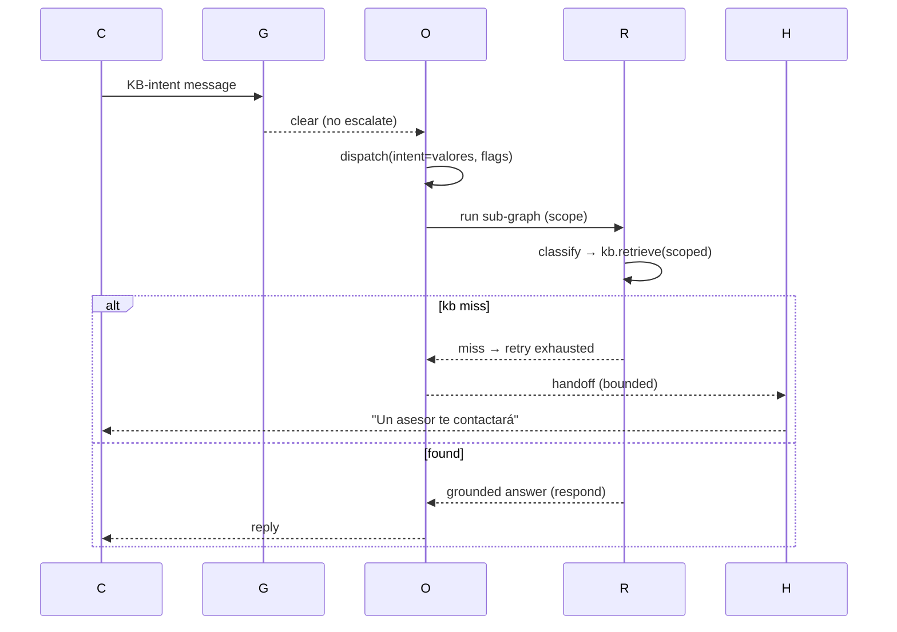

# Design: H2 — Multi-Agent LangGraph Router

## Technical Approach

Supervisor-with-subgraphs (proposal approach 1). Keep `build_graph()` as the orchestrator shell; the deterministic gates (`emergency_gate → cost_gate → handoff_gate`) stay a fixed pre-LLM prefix (AO-4). Replace the `route` node with an `orchestrate` node dispatching on a pure `(intent, gate flags)` function (AO-3) to sub-graphs wrapping vetted nodes (AO-5). Registry becomes multi-agent data consumed by a read-only startup reader (AO-2). Slice 1 ships router + KB research/triage sub-graph. Graph confirms `graph.py --imports_from--> respond.py`; no registry consumer exists today (AC-4).

## Architecture Decisions

| # | Decision | Tradeoff | Choice |
|---|----------|----------|--------|
| D1 | Schema | Mutating `agent:` breaks one-orchestrator test | **Sibling** `sub_agents:` |
| D2 | Reader | In `prompts.py` breaks no-runtime-consumer test | **`app/agent_registry.py`** |
| D3 | Enforcement | Reader-side violates AC-4 | **At dispatch** only |
| D4 | Sub-graph | Separate graph vs direct calls | **Thin sub-graph** reusing vetted nodes |
| D5 | Whitelist | Service layer over-engineers | **assert-in-dispatch** |
| D6 | KB scope | New table forbidden | **Optional filter on `source_meta.category`** |
| D7 | Retry | Unbounded loops | **≤1 retry → handoff** |

## Registry Schema (AO-1, AC-4 delta)

```yaml
agent:                          # IN TACT (AC-4)
  name: orchestrator
  persona: personas/orchestrator.md
  skills: [sdb, emergency, handoff, capture]
  tools_whitelist: []
  kb_scope: null
  memoria_scope: null
  model: deepseek-chat
sub_agents:                     # SIBLING (new)
  research_triage:
    name: kb-research-triage
    persona: personas/research_triage.md
    tools_whitelist: ["kb.retrieve"]
    kb_scope: ["valores", "postventa"]
    memoria_scope: "customer"
    model: deepseek-chat
    temperature: 0
  # retrieval, customer_records, human_handoff, escalation:
  # same 7 fields; data-only in slice 1 (no runtime behavior)
```

Reader validation: fail-fast at boot on missing field, unknown `tools_whitelist` value, invalid `temperature`; exactly one `agent:` key with `name == orchestrator`. The known-tools set for slice-1 is `["kb.retrieve"]` — the only tool the research_triage sub-graph uses — and the reader validates every whitelist entry against it, failing fast on anything else; the set grows in later slices. `load_registry()` runs once at graph construction inside `app/chat/graph.py` (module scope, cached) and is NOT wired into `prompts.py`/`respond.py` — compatible with `test_registry_has_no_runtime_consumer`, which scans only those two files.

## Orchestrator Node

Sits after `handoff_gate` (clear path), before sub-graphs. Pure dispatch on `(intent, gate flags)`, no LLM. State additions: `active_sub_agent`, `triage_retry`. Routing table enumerable — all `(intent, flags)` rows tested (AO-3).

| Intent / condition | Flags | Dispatch (H2) | Today's equivalent |
| --- | --- | --- | --- |
| any (post-gates) | `escalate=True` (2x unknown, injection, SS-1 always_escalate) | handoff (escalation) — unchanged | route.py:25-30 |
| persona | — | handoff (escalation, reason=persona) — unchanged | route.py:34-35 |
| emergencia | `emergency=True` | handoff (escalation, reason=emergencia) — unchanged | route.py:36-37 |
| injection | `escalate=True` | handoff (escalation, reason=injection_detected) — unchanged | route.py:38-40 |
| calefont, caldera, calefaccion, solicitar_visita (CAPTURE_INTENTS) | — | capture sub-flow — unchanged | route.py:41-42 |
| valores, postventa (RETRIEVAL_INTENTS) | — | **research_triage sub-graph (KB, H2) — changed** | route.py:43-44 (`kb_retrieve` → `respond`) |
| unknown (1st time, no escalate) | — | respond (clarification) — unchanged | route.py:45-49 |
| anything else | — | respond (linear) — unchanged | route.py:50 |

The mid-capture shortcut is preserved: when `_pending` is in `state.captured`, the flow goes `receive → capture` directly, skipping re-classification (graph.py `_flow_start`).

## Sub-Graph: Research/Triage (slice-1)

```
orchestrate → research_triage:
  classify_intent (reused) → kb.retrieve(scope=kb_scope) → respond (reused)
  kb_miss → retry(≤1) → handoff                        # AO-8 bounded
```

Scope injected via the sub-graph dispatch call to `kb.retrieve(scope=kb_scope)`. The filter keys on `kb_chunks.source_meta.category` (JSONB convention, no new column/table): documents ingested with a category store `source_meta: {"category": "..."}`; `retrieve` adds `source_meta.category IN scope` when scope is provided, and `scope=None` returns the unfiltered active-version set (backward compatible). `respond` consumes the chunks unchanged (graph.py→respond.py edge preserved). The KB upload/seed path (existing `ingest_document`/`update_document` in `app/services/kb.py`) accepts an optional category stored into `source_meta`, so the filter has data — an extension of the EXISTING ingest path, not a new panel endpoint (panel inbox/chat endpoints stay out of scope).



Mechanism honesty: slice-1 delivers scoped retrieval + bounded retry (≤1) + explicit escalation — it does NOT guarantee fewer escalations on KB intents (same corpus, same `min_sim` threshold). "Fewer escalations on KB intents" is the post-slice OBSERVATION TARGET, not a slice-1 mechanism guarantee.

## Tools Whitelist (AO-6), KB/Memory Scoping (AO-7)

Whitelist = assert-in-dispatch: `sub_agent.tools_whitelist` gates service calls (`kb.retrieve` allowed; others log + `handoff`). `kb.retrieve` gains optional `scope: list[str] | None` (additive) filtering on `source_meta.category`; `None` = unfiltered. Memory stays customer-scoped (unchanged `memory.py`).

## File Changes

| File | Action | Description |
|------|--------|-------------|
| `agent/registry.yaml` | Modify | Add `sub_agents:` sibling |
| `agent/personas/research_triage.md` | Create | Slice-1 persona |
| `app/agent_registry.py` | Create | Read-only reader + validation |
| `app/services/kb.py` | Modify | Optional `scope` filter (D6) |
| `app/chat/graph.py`, `state.py` | Modify | `orchestrate`, `_dispatch`, state fields |
| `app/chat/nodes/orchestrate.py` | Create | Dispatch + whitelist guard |
| `app/chat/subgraphs/research_triage.py` | Create | Thin sub-graph |
| `tests/unit/test_agent_registry.py` | Create | Reader + AC-4 compat |
| `tests/unit/test_routing_table.py` | Create | `(intent, flags)` table |

## Interfaces / Contracts

`load_registry() -> Registry` (frozen `Agent`/`SubAgent` dataclasses; `orchestrator`, `sub_agents: dict`). `kb.retrieve(..., scope=None)` filters chunks by `source_meta.category` when scope is provided; `scope=None` returns unfiltered (backward compatible). Tool call enforced at dispatch: must be whitelisted else log+handoff.

## Testing Strategy

| Layer | What | Approach |
|-------|------|----------|
| Unit | Reader fails-fast, AC-4 invariant, no reads in prompts/respond | `test_agent_registry.py` |
| Unit | Routing table all combos, no LLM | `test_routing_table.py` |
| Integration | Research resolves; miss → retry → handoff | extend `test_chat_intent` |
| Regression | `test_chat_intent`, `test_handoff`, `test_cost_guardrails`, `test_prompts` green | `.venv/bin/pytest` |

Baseline green: `test_prompts.py` 26 passed (AC-4 one-orchestrator + no-runtime-consumer).

## Cost Integration (AO-10)

`conversation_spend`/`daily_spend` SUM `messages.cost_llm` (D6) — every call (classify + orchestrator + sub-agents) accumulates on the same row via `record_llm_cost` (`LLM_RATES` is multi-model). Thresholds `$1.50`/conversation and `$5.00`/day **stay unchanged** (user-confirmed). `conservative` brief + `blocked` escape already bound multi-call turns.

## Slice Boundaries

- **Slice 1**: router + research/triage (persona, scoped retrieve, read-only reader, orchestrate node) + table tests.
- **Later**: 4 sub-agents (data-only now), whitelist enforcement hardening, per-agent `memoria_scope` wiring.

## Threat Matrix

N/A — dispatch is in-process node selection; no executables, shell/subprocess, or VCS/PR automation introduced.

## Non-Goals

No checkpointer, production panel endpoints, new DB tables, `audit_log` dispatch entries, gate redesign, threshold change.

## Open Questions

- [ ] Persona phrasing for `research_triage.md` (resolved in tasks).

## Migration / Rollout

Registry data-only → no DB migration. Rollback = git revert of the graph/nodes/registry wiring; no feature flag is introduced (YAGNI).
