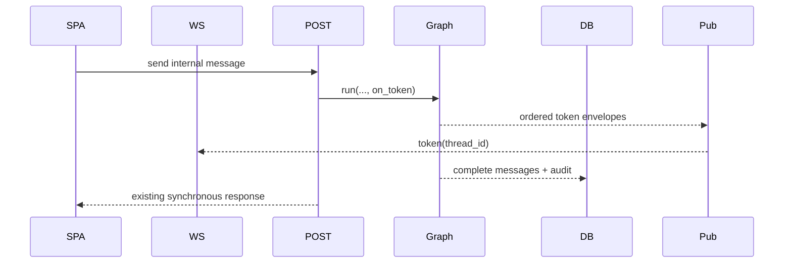
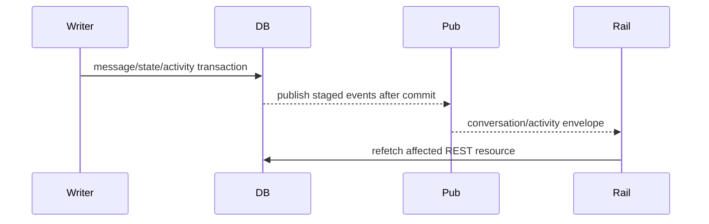

# Design: Conversation Realtime

## Technical Approach

Add an authenticated, best-effort FastAPI WebSocket stream backed by an in-process publisher. REST remains authoritative: commands commit before publication, connect sends a database snapshot, and reconnect refetches REST. Extend existing writers and `ConversationEvent` without introducing a replay bus, activity table, or multi-process fan-out.

Graphify consultation: `ConversationEvent` → `models.py`; `panel_router` → `api_router`; `agent_chat.py` → `graph.py`; SPA → `api.ts`/`PanelShell`; nginx → Vite/API proxy. `GRAPH_REPORT.md` identifies `models.py`, `graph.py`, `panel/deps.py`, and `vite` as hubs.

## Architecture Decisions

| Decision | Choice | Alternatives / rationale |
|---|---|---|
| Transport | `/panel/ws`, envelope `{type, conversation_id?, data}`, types `token`, `message`, `conversation`, `activity`, `snapshot`. | SSE/replay rejected; one channel plus REST recovery preserves the approved contract. |
| Publisher | `app/services/realtime.py`, one bounded `asyncio.Queue` per subscriber, conversation filtering, drop-on-full cleanup. | Redis/general bus is out of scope for the single-process v1. |
| Commit boundary | Stage payloads in `session.info`; `session_scope()` drains after commit. | Prevents rollback ghost events; publication failure never fails commands. |
| Chat seam | Add optional `on_token` to the existing graph-owned internal-chat call; chunk its sole complete result for delivery, while `agent_chat.submit_message()` persists the complete response and keeps its POST shape. | No async rewrite or new authorization scope. |
| Activity semantics | Add an activity-writer validator for `classified` and `kb_retrieved`, and reuse the existing `escalation` writer. Activity queries filter `ConversationEvent.event IN (...)` for ficha history. | Do **not** constrain the whole column/table: existing writers intentionally persist `state_change`, `unknown_intent`, `emergency`, and `escalation` (`state.py:112-119`, `classify_intent.py:118-135`, `emergency.py:85-91`, `handoff.py:82-88`). |

## Data Flow





On connect, `app/panel/api/routes/realtime.py` authenticates and sends `snapshot` before subscribing. On reconnect, the SPA refetches conversations, active summary, and the open thread/ficha before marking recovered; no replay.

## File Changes

| File | Action | Description |
|---|---|---|
| `app/services/realtime.py` | Create | Bounded process-local publisher and post-commit dispatch. |
| `app/panel/api/routes/realtime.py` | Create | WebSocket endpoint with snapshot and session-cookie authorization. |
| `app/panel/routes/__init__.py` | Modify | Import and include `realtime.router` directly in `panel_router`; this mounts `/panel/ws` (not `/panel/api/ws`). `app/panel/api/__init__.py` remains the JSON `/panel/api` aggregator. |
| `app/panel/api/deps.py`, `app/db.py` | Modify | Reuse signed-session resolution and dispatch staged events after commit. |
| `app/models.py`, `db/migrations/018_conversation_realtime.sql` | Modify/Create | Activity-writer validation and indexes; no global event CHECK. Add active partial index on bot/human, non-null recency. |
| `app/chat/**`, `app/services/agent_chat.py`, conversation/webhook services | Modify | Activity writes, token callback, and `last_message_at` updates. |
| `app/panel/api/routes/conversations.py`, `serializers.py` | Modify | `GET /panel/api/conversations/active`, customer join, activity-only ficha query. |
| `web/src/{realtime.ts,api.ts,types.ts}`, shell/pages | Create/Modify | One lifecycle-safe client, reducers, rail, activity and token states. |
| `web/vite.config.ts` | Modify | Add `'/panel/ws': { target: 'ws://localhost:8000', ws: true }` beside `/panel/api`. |
| `infra/nginx/panel.lumat.cl.conf`, `infra/nginx/agente.lumat.cl.conf`, `infra/nginx/snippets/*` | Modify/Create | Dedicated exact/prefix `/panel/ws` location using HTTP/1.1, `Connection "Upgrade"`, `Upgrade $http_upgrade`, `proxy_read_timeout 1h`, and `proxy_send_timeout 1h`; retain `proxy-pass.conf`’s `Connection ""` for ordinary HTTP. |

## Interfaces / Contracts

```ts
type RealtimeEnvelope = { type: "token" | "message" | "conversation" | "activity" | "snapshot"; conversation_id?: number; data: unknown };
```

The active query joins `Conversation` to `Customer`, requires `state IN (bot,human)`, non-null `last_message_at` within 24 hours, and orders `last_message_at DESC, id DESC`. `get_current_user_json()` reads the signed session cookie and active `User`; operators may use panel realtime, while internal-chat data remains admin-only.

## Testing Strategy and Phases

Strict RED→GREEN; every slice is ≤400 changed lines: (1) event writer/query filter, publisher, post-commit/no-ghost; (2) token callback and unchanged POST; (3) route registration, cookie auth, snapshot-first, cleanup; (4) activity/recency writers and history; (5) active endpoint exclusions/order/customer join; (6) fake-WebSocket SPA lifecycle, roles and refetch; (7) rail plus Vite/nginx upgrade assertions and full gates.

## Threat Matrix

| Boundary | Applicability | Safe/failure behavior | Planned RED tests |
|---|---|---|---|
| Documentation-like paths | N/A — no documentation execution | None | None |
| Git repository selection | N/A — no VCS automation | None | None |
| Commit state | N/A — no commit automation | None | None |
| Push state | N/A — no push automation | None | None |
| PR commands | N/A — no PR command execution | None | None |
| HTTP/WebSocket routing | Applicable | `/panel/ws` is registered on `panel_router`; Vite and nginx preserve upgrade; REST remains usable on proxy failure. | Route mount, cookie rejection, Vite `ws:true`, nginx upgrade/timeout assertions. |

## Migration / Rollout

Run migration 018 before enabling the socket. Roll back code/config without deleting historical events; REST remains authoritative. Single API process only.

## Open Questions

None blocking.
